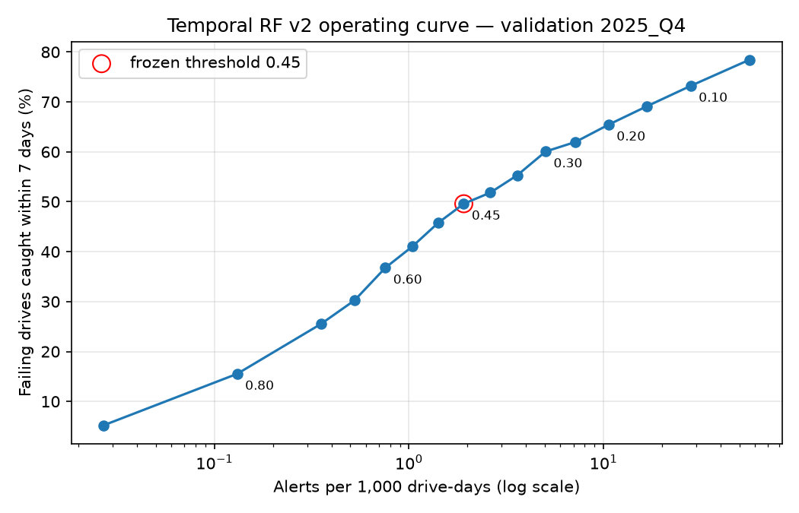

# Temporal RF v2 operating curve (validation 2025_Q4)

VALIDATION ONLY (2025 Q4); frozen Temporal RF v2; locked 2026 Q1 test not read; nothing changed. 18,851,395 drive-days, 206,929 drives, 631 drives failing within the 7-day window.

| Threshold | Failing drives caught | Alerts / 1,000 drive-days | Drives flagged | Flagged drives that fail | Drives flagged per failure caught | Extra checks per extra failure (vs next higher) | Row precision | Median lead (days) |
|---:|---|---:|---:|---:|---:|---:|---:|---:|
| 0.05 | 495 / 631 (78.5%) | 56.32 | 63,357 | 0.9% | 128.0 | 951.9 | 0.23% | 7.0 |
| 0.10 | 462 / 631 (73.2%) | 28.08 | 31,945 | 1.6% | 69.1 | 461.3 | 0.42% | 7.0 |
| 0.15 | 436 / 631 (69.1%) | 16.66 | 19,951 | 2.4% | 45.8 | 222.4 | 0.63% | 7.0 |
| 0.20 | 413 / 631 (65.5%) | 10.63 | 14,835 | 3.0% | 35.9 | 162.3 | 0.91% | 7.0 |
| 0.25 | 391 / 631 (62.0%) | 7.17 | 11,265 | 3.8% | 28.8 | 232.7 | 1.23% | 7.0 |
| 0.30 | 379 / 631 (60.1%) | 5.04 | 8,473 | 4.9% | 22.4 | 72.5 | 1.62% | 7.0 |
| 0.35 | 349 / 631 (55.3%) | 3.60 | 6,297 | 6.3% | 18.0 | 69.4 | 2.06% | 7.0 |
| 0.40 | 327 / 631 (51.8%) | 2.62 | 4,770 | 7.8% | 14.6 | 72.1 | 2.55% | 6.0 |
| 0.45 **(frozen)** | 313 / 631 (49.6%) | 1.91 | 3,761 | 9.4% | 12.0 | 30.7 | 3.14% | 6.0 |
| 0.50 | 289 / 631 (45.8%) | 1.42 | 3,025 | 11.3% | 10.5 | 20.8 | 3.72% | 6.0 |
| 0.55 | 259 / 631 (41.0%) | 1.04 | 2,401 | 13.0% | 9.3 | 20.2 | 4.39% | 5.0 |
| 0.60 | 232 / 631 (36.8%) | 0.76 | 1,855 | 15.3% | 8.0 | 9.8 | 5.21% | 5.0 |
| 0.65 | 191 / 631 (30.3%) | 0.53 | 1,454 | 16.9% | 7.6 | 13.1 | 5.79% | 5.0 |
| 0.70 | 161 / 631 (25.5%) | 0.35 | 1,060 | 19.8% | 6.6 | 7.9 | 6.76% | 5.0 |
| 0.80 | 98 / 631 (15.5%) | 0.13 | 560 | 23.9% | 5.7 | 6.0 | 9.66% | 4.0 |
| 0.90 | 33 / 631 (5.2%) | 0.03 | 170 | 28.8% | 5.2 | – | 14.74% | 5.0 |

